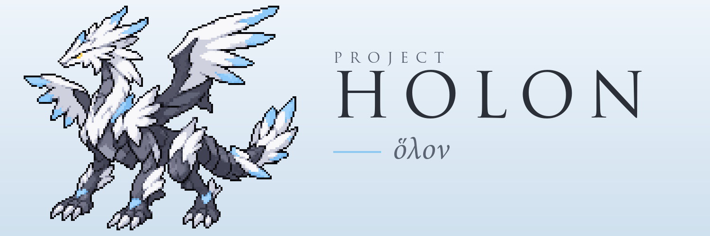

<h1></h1>

<p>
  <a href="https://project-holon.com/"></a>
  <a href="https://x.com/projectholon"></a>
  <a href="https://www.patreon.com/cw/project_holon"></a>
</p>

A decompilation of Pokémon Black and White, a native PC port built on it,
and a modding suite for the port.

## Projects

| Project | What it is | State |
| --- | --- | --- |
| [aletheia](https://github.com/Project-Holon/aletheia) | Decompilation of Pokémon Black and White, with its own tooling | 100% matched; rebuilds both ROMs byte-identical from your dump |
| [eidos](https://github.com/Project-Holon/eidos) | Native PC port: the decompiled game code compiled for the PC, with its own platform layer and DS hardware replacements | Plays the opening hours of the game |
| [kenon](https://github.com/Project-Holon/kenon) | Modding suite for the port: data, graphics, text and map editors | Editors done; mod packages next |

## How they fit together

```
your own ROM dump
      |
   aletheia   decompiled C source, data formats and tools
      |
    eidos     compiles that source for the PC and runs the game
      |
    kenon     edits the game data; eidos loads the result as a mod
```

No project contains game data. Each reads it from your own dump.
